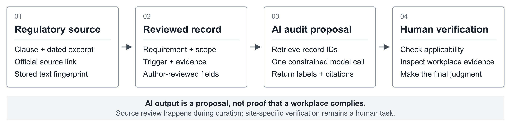

# ComplianceKB

**Turn a regulatory passage into a traceable audit proposal—with explicit human review.**

ComplianceKB (**Compliance Knowledge Base**) links selected OSHA requirements to their sources, scope, activating events, expected evidence and verification methods. It implements the Regulatory Knowledge Model (RKM) as reusable infrastructure for human-supervised compliance AI.

**[Read the paper](paper/ComplianceKB_Manuscript.pdf)** · **[View the poster](poster/ComplianceKB_ESS_2026.pdf)** · [Browse the dataset](data/releases/v1.2.0/) · [Reproduce results](docs/REPRODUCIBILITY.md) · [Project QR code](sharing/ComplianceKB_QR.png)

**Eugene Sun and Dupeng Liu · Research conducted during a TrusOne internship.** Preparing for the accepted **AIAS+ 2026 / Chen Institute** poster presentation. The revised manuscript is under publication-eligibility review for possible **ACM ICPS proceedings** inclusion; publication is not confirmed. [Status and sources](docs/PUBLICATION_STATUS.md)

## How it works



The source passage provides the regulatory basis; reviewed fields make the interpretation reusable. The implemented agent retrieves records and makes **one constrained model call** to propose IDs, operational labels, citations and a decision. People still verify applicability, workplace evidence and final judgments. [Exact method and formulas](docs/METHODS.md) · [Editable diagram](docs/figures/how_it_works.svg)

## One concrete example: annual energy-control inspection

**Scenario DEV-006:** “The anniversary of the last review of a machine-specific energy-control procedure is approaching.” This is an existing synthetic development scenario, not a real factory audit.

| Step | What you can inspect |
|---|---|
| **1 · Regulatory source** | Stored excerpt from **§1910.147(c)(6)(i)**: “The employer shall conduct a periodic inspection of the energy control procedure at least annually…” [Source link](https://www.ecfr.gov/current/title-29/part-1910/section-1910.147#p-1910.147(c)(6)(i)); stored source version: 2024-07-01. |
| **2 · Reviewed record** | **OSHA-LOTO-005** connects `annual_review` → `inspection_record` → `record_review`, alongside the source and applicability descriptors. |
| **3 · Actual saved AI output** | GPT-5.6-terra / RKM returned **OSHA-LOTO-005**, `annual_review`, `inspection_record`, the same citation, and decision `answer`. [Inspect the unchanged saved response](research/benchmark/runs/llm_development_20260927/openai/rkm_agent/DEV-006.json). |
| **4 · Human verification still needed** | Confirm scope and exceptions; inspect authentic inspection evidence and dates; determine what actually happened at the site. **No workplace check or final compliance confirmation was performed in this example.** |

`answer` means the model supplied a response under the benchmark policy; it does **not** mean the facility passed an audit. This case matches its reference labels; the full benchmark includes errors and mixed results. [Full walkthrough, exact JSON and a failure case](docs/WALKTHROUGH.md) · [Machine-readable example](examples/end_to_end_loto.json)

## What is distinctive

The focus is the **combination**, not a claim that OSHA datasets or regulatory AI are new:

- **Selected requirements across four frameworks:** PSM, HazCom, Recordkeeping and LOTO—not exhaustive regulatory coverage.
- **Operational, source-linked records:** applicability, triggers, evidence and verification methods connect text to proposed checks.
- **Inspectable human review:** documented corrections, frozen releases, historical source-review fields and independent second-person annotation-agreement analysis.
- **A testable agent comparison:** saved outputs and scoring code compare excerpt contexts with richer RKM records using the same models and hybrid candidate IDs.

Our targeted review did not identify a public dataset for which this entire combination could be confirmed. This is **not** a first/only claim. [Related resources and search limits](docs/RELATED_RESOURCES.md) · [Review/correction artifacts](research/source_review/) · [Annotation results](research/annotation/)

## What the experiment shows

**24 AI-assisted, author-confirmed development scenarios × 5 inputs × 2 models = 240 saved responses.**

| Model | Context | Requirement F1 | Trigger F1 | Evidence F1 | Decision accuracy |
|---|---|---:|---:|---:|---:|
| GPT-5.6-terra | Hybrid | .801 | .693 | .681 | .917 |
| GPT-5.6-terra | RKM | .789 | .824 | .838 | .917 |
| Claude Sonnet 5 | Hybrid | .745 | .628 | .544 | .958 |
| Claude Sonnet 5 | RKM | .771 | .858 | .888 | .958 |

RKM improves **trigger and evidence label recovery** in these paired comparisons. Requirement/citation gains are inconsistent; decision accuracy is unchanged. There is no independent holdout, the scenarios share the label taxonomy, and RKM adds information and context tokens. These scores do not establish legal correctness, calibrated safety or measured labor savings. [All results and saved responses](research/benchmark/runs/) · [Paired results figure](docs/figures/paired_results.svg)

## Run it without an API key

From the repository root, with Python 3.12 or later:

```bash
python tools/demo.py --query "annual energy control inspection"
python tools/check_release.py
python tools/reproduce.py
```

The demo runs BM25 retrieval and displays stored fields; it does not generate a new AI decision. Reproduction rescores saved answers, rankings and annotations without paid calls or model downloads. [Full setup and optional retrieval/model reruns](docs/REPRODUCIBILITY.md)

## Find the materials

| Material | Location |
|---|---|
| **Experimental dataset: 108 records** | [`data/releases/v1.2.0/`](data/releases/v1.2.0/) — JSON, CSV, JSON-LD and SQL |
| **Later extension: 133 records** | [`data/releases/v1.5.0/`](data/releases/v1.5.0/) — not evaluated by the reported 240-call experiment |
| Agent, retrieval and scoring | [`research/benchmark/`](research/benchmark/) — BM25, MiniLM, hybrid, model runner and post-hoc E5 sensitivity |
| Source review and independent labels | [`research/source_review/`](research/source_review/) · [`research/annotation/`](research/annotation/) |
| Full manuscript and ESS poster | [`paper/`](paper/) · [`poster/`](poster/) |
| Schema, methods and release history | [Dataset card](docs/DATASET_CARD.md) · [Schema](data/SCHEMA.md) · [Methods](docs/METHODS.md) · [Releases](docs/RELEASES.md) |

The 108 experimental records received author source review with AI assistance. A second annotator labeled 50 retained IDs from the original 89-record pool; unadjudicated nominal κ was **risk .234, evidence .642, trigger .443**. Agreement measures consistency, not expert correctness. [Codebook](docs/annotation_codebook.md)

## Scope, reuse and sharing

Only OSHA examples were evaluated. Applicability is descriptive, not an executable legal rule engine; excerpt hashes fingerprint stored text, not legal validity or temporal reasoning. People remain responsible for source-version checks, site facts, exceptions, evidence authenticity and final judgments.

**Code: [MIT](LICENSE-CODE.txt). Data/annotations: [CC BY 4.0](LICENSE-DATA.txt).** Poster and third-party assets have separate attribution considerations: [NOTICE](NOTICE.md). [Cite this project](CITATION.cff).

Share **https://github.com/eugeneasun/ComplianceKB** or the [QR code](sharing/ComplianceKB_QR.png). Visitors can read the paper, inspect records and download everything via **Code → Download ZIP** or a [packaged release](https://github.com/eugeneasun/ComplianceKB/releases). Prepared for the Berkeley Engineering undergraduate poster session on October 15, 2026; [AIAS+ / ACM review status](docs/PUBLICATION_STATUS.md).
